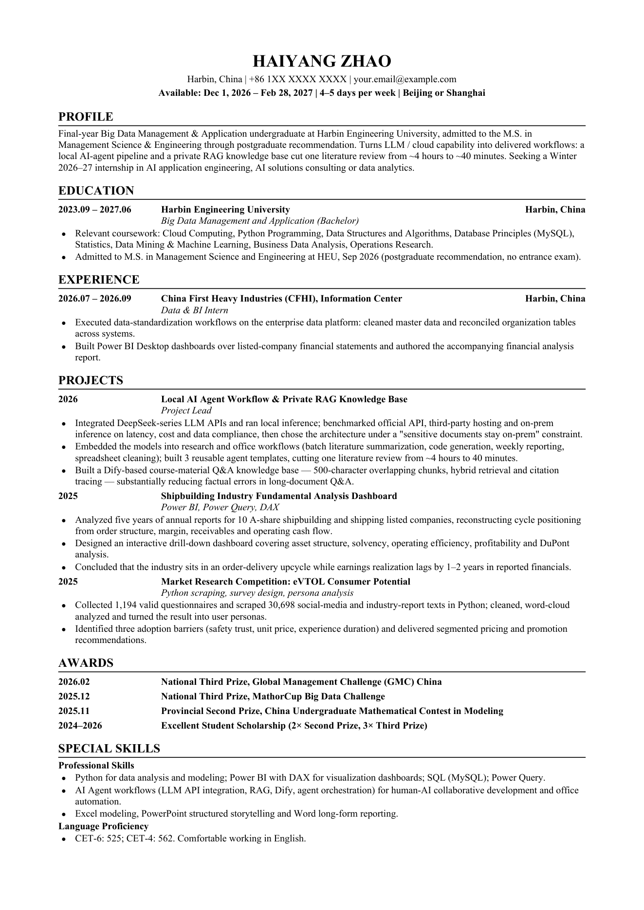

# english-resume

Generate a **one-page English resume** for foreign-owned / multinational company
applications — from a YAML file, into DOCX **and** PDF, with no Word and no browser
required.



The layout is the classic Times New Roman, tab-aligned international student format:
centred name, ALL-CAPS section headings with a hairline rule, `date | organisation | role |
location` on one row, `●` bullets with hanging indent.

What this repo actually adds on top of a template file is the **automation and the rules**:

- **Auto-fit to one page.** The builder measures every line with real font metrics and
  shrinks the body from 10 pt in 0.1 pt steps until the document fits. No more guessing
  whether that last bullet spills onto page 2.
- **Rows that never overflow.** A long award name or project title wraps underneath instead
  of running off the right margin; a row that cannot hold four fields drops the role to a
  second italic line.
- **Content rules, not just millimetres.** `references/content-rules.md` lists what a
  foreign-owned employer expects to see and what to delete (photo, date of birth, political
  affiliation, self-rated skills) — and why each one costs you interviews.
- **Phrasing patterns.** `references/phrasing.md` has a verb bank, quantification templates,
  before/after rewrites, and the standard English for Chinese institutions, competitions and
  course names.

## Quick start

```bash
pip install -r requirements.txt

cp examples/haiyang-zhao.yaml resume.yaml      # then edit resume.yaml
python scripts/build.py resume.yaml --png      # writes out/*.docx, *.pdf, *.png
```

Open `out/*.png` to check the page, then **send the PDF** — not the DOCX.

## How it works

Content lives in YAML; layout lives in `scripts/build.py`. The DOCX is produced with
`python-docx` and the PDF is drawn directly with `PyMuPDF`, so the builder runs anywhere
Python runs — including locked-down machines where Word COM automation and headless-browser
printing are blocked. Both outputs are driven by the same `SPEC` dict, so they cannot drift
apart.

## YAML shape

```yaml
name: HAIYANG ZHAO
contact: "Harbin, China  |  +86 1XX XXXX XXXX  |  your.email@example.com"
availability: "Available: Dec 1, 2026 – Feb 28, 2027  |  4–5 days per week  |  Beijing or Shanghai"

sections:
  - type: paragraph
    title: PROFILE
    text: >
      Final-year undergraduate ... one paragraph, 3–4 lines.

  - type: entries
    title: EXPERIENCE
    entries:
      - date: "2026.07 – 2026.09"
        org: "China First Heavy Industries (CFHI), Information Center"
        role: "Data & BI Intern"
        location: Harbin, China
        bullets:
          - "Executed data-standardization workflows on the enterprise data platform ..."

  - type: skills
    title: SPECIAL SKILLS
    groups:
      - label: "Professional Skills"
        items:
          - "Python for data analysis and modeling; Power BI with DAX ..."
```

Three section types only: `paragraph`, `entries`, `skills`. In `entries`, `role`,
`location` and `bullets` are all optional.

## CLI

```
python scripts/build.py <content.yaml> [-o outdir] [-n stem] [--png]
                                       [--max-pages 1] [--body-pt 9.5]
```

| Flag | Meaning |
|---|---|
| `--max-pages 1` | default — shrink body size until it fits this many pages |
| `--body-pt 9.5` | pin the body size, skip auto-fit |
| `--png` | also write a first-page PNG preview |
| `-o`, `-n` | output directory / file stem |

The builder prints the chosen body size. Below 9.0 pt it prints a hint, because past that
point the right move is to cut content rather than shrink type.

## Layout, exactly

| Item | Value |
|---|---|
| Paper | A4, margins 1.70 / 1.60 / 1.90 / 1.90 cm |
| Name | Times New Roman 16 pt bold, centred |
| Section heading | Times New Roman 11.5 pt bold, ALL CAPS, 0.75 pt rule |
| Body | Times New Roman 10 pt (auto-shrunk), line advance 1.16 × size |
| Columns | date tab 3.35 cm · role tab 8.55 cm · location right at 17.20 cm |
| Bullets | `●` at body × 0.80, indent 0.55 cm with −0.45 cm hanging |

Full specification: [`references/layout-spec.md`](references/layout-spec.md).

## Repository layout

```
SKILL.md              agent-facing instructions (rules first, commands second)
manifest.yaml         which reference loads when
references/
  content-rules.md    what to include, what to delete, section order, one-page triage
  phrasing.md         verbs, quantification, Chinese→English rewrites
  layout-spec.md      the numbers above
examples/
  haiyang-zhao.yaml   a real, buildable resume
scripts/build.py      the generator
templates/
  resume-template.docx  the original Word template, kept as the visual reference
docs/preview.png      rendered preview
```

## Use it as an agent skill

`SKILL.md` has the YAML front matter (`name`, `description`, `whenToUse`) that DeepSeek
Harness and compatible agent runtimes expect. Drop this folder into your skills directory:

```bash
# DeepSeek Harness
cp -r english-resume ~/.dsh/skills/
```

Then the skill is picked up whenever a task involves writing or translating an English
resume for a multinational employer.

## Notes and limitations

- Windows uses the real `times*.ttf` from `C:\Windows\Fonts`; elsewhere the builder falls
  back to the PDF base-14 Times equivalents, which share the same metrics, so wrapping is
  identical.
- Word's own pagination can differ from the rendered PDF by a line. Trust the PDF; submit
  the PDF.
- The builder never invents numbers. If a bullet lacks a figure, quantify the scope
  (companies analysed, records processed, options compared) or describe the decision.

## License

MIT — see [LICENSE](LICENSE).
